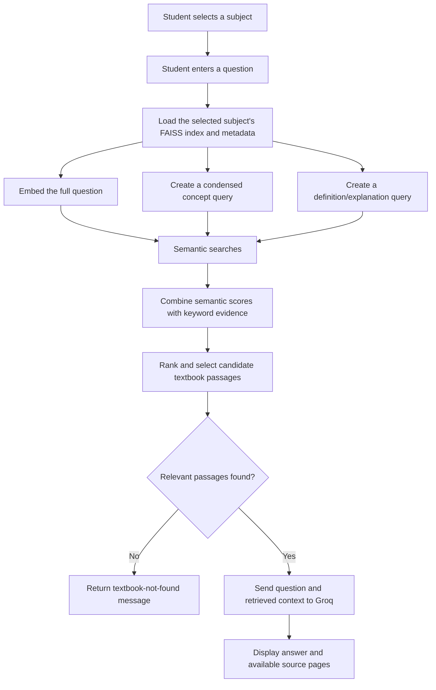

# 📚 AI Study Assistant — Class 11

A textbook-grounded study assistant built with **Streamlit, FAISS, Sentence Transformers, and Groq**. Students select a subject, ask a question in natural language, and receive an answer generated from the selected subject's indexed textbook content, with source-page references where available.

> **Important:** The application is designed to answer from the supplied textbook context rather than from general internet knowledge. Retrieval quality depends on the quality, completeness, and correct alignment of the vector index and its metadata.

## Table of Contents

- [Features](#features)
- [Supported Subjects](#supported-subjects)
- [Technology Stack](#technology-stack)
- [How It Works](#how-it-works)
- [Project Structure](#project-structure)
- [Requirements](#requirements)
- [Local Setup](#local-setup)
- [Configure the Groq API Key](#configure-the-groq-api-key)
- [Vectorstore Requirements](#vectorstore-requirements)
- [Run the Application](#run-the-application)
- [Deploy on Streamlit Community Cloud](#deploy-on-streamlit-community-cloud)
- [Troubleshooting](#troubleshooting)
- [Security and Privacy](#security-and-privacy)
- [Current Limitations and Roadmap](#current-limitations-and-roadmap)

## Features

- **Textbook-grounded answers:** Supplies retrieved textbook passages to the language model and instructs it not to use outside knowledge.
- **Subject selection:** Physics, Chemistry, Biology, and Computer Science.
- **Multi-query hybrid retrieval:** Searches with the original question, a condensed concept query, and a definition/explanation query. It combines semantic similarity with supporting keyword signals so exact wording is not intended to be mandatory.
- **FAISS vector search:** Retrieves candidate passages/pages from the index associated with the selected subject.
- **Three answer formats:** Explanation, Summary, and Quiz.
- **Source references:** Displays the page number and a short text snippet for each retrieved source when page metadata is present.
- **Class 11-focused responses:** Prompts the model to use clear student-level language and plain-text formulas.
- **Consistent revision summary:** Instructs the model to end answers with an `### In Short:` section.
- **Streamlit interface:** Subject selector, suggested prompts, question field, answer mode selector, answer display, and source cards.
- **API key stored as a secret:** The Groq API key is read from Streamlit secrets rather than being hard-coded in the application.

## Supported Subjects

The current app configuration maps each subject to a separate vectorstore directory:

| UI subject | Vectorstore directory |
|---|---|
| Physics | `vectorstore/phy/` |
| Chemistry | `vectorstore/chem/` |
| Biology | `vectorstore/bio/` |
| Computer | `vectorstore/computer/` |

Each selected subject is searched separately. Make sure every configured directory contains the correct index and matching metadata.

## Technology Stack

- **Python** — application logic
- **Streamlit** — web interface
- **Groq Python SDK** — language-model API
- **Groq model configured in the app:** `openai/gpt-oss-120b`
- **Sentence Transformers** — text embeddings using `sentence-transformers/all-MiniLM-L6-v2`
- **FAISS** — nearest-neighbour vector retrieval
- **NumPy** — numerical array handling

## How It Works



### Retrieval and answer generation

1. The app loads the FAISS index and metadata for the selected subject.
2. It embeds the student's full question and additional query forms, including a condensed concept query and a definition-oriented query.
3. It combines semantic similarity values with a smaller keyword-matching signal and ranks candidate passages.
4. If retrieval returns no acceptable candidates, the app displays: `I couldn't find this information in the selected textbook.`
5. If candidates are retrieved, the app adds their text and page references to the prompt sent to Groq.
6. The language model is instructed to answer only from the supplied context. Retrieved context is the evidence source; the model prompt alone cannot guarantee zero hallucinations, so results should be validated during testing.

**Architecture note:** The current implementation is a multi-query hybrid RAG pipeline. It is not yet an autonomous agent with tool-calling and an iterative retry loop.

## Project Structure

The repository should follow this layout (subject folders must match `SUBJECT_KEYS` in `app.py`):

```text
ai-study-assistant/
├── app.py
├── requirements.txt
├── README.md
├── vectorstore/
│   ├── phy/
│   │   ├── index.faiss
│   │   └── metadata.json
│   ├── chem/
│   │   ├── index.faiss
│   │   └── metadata.json
│   ├── bio/
│   │   ├── index.faiss
│   │   └── metadata.json
│   └── computer/
│       ├── index.faiss
│       └── metadata.json
└── .streamlit/
    └── secrets.toml   # local only; do not commit
```

The textbook PDFs and the notebook/script used to build the indexes may be stored separately. The Streamlit app expects the prebuilt FAISS index and metadata to be available at runtime; it does not currently build indexes from PDFs through the UI.

## Requirements

The project uses these Python packages, listed in `requirements.txt`:

```text
streamlit
groq
faiss-cpu
sentence-transformers
numpy
```

Use a supported Python version compatible with the listed packages. On first run, Sentence Transformers may download the embedding model, so initial startup can take longer and requires network access to retrieve that model if it is not cached.

## Local Setup

### 1. Clone the repository

```bash
git clone <YOUR_GITHUB_REPOSITORY_URL>
cd <YOUR_REPOSITORY_FOLDER>
```

Replace the placeholder URL and folder name with your own repository details.

### 2. Create and activate a virtual environment (recommended)

**Windows PowerShell:**

```powershell
python -m venv .venv
.\.venv\Scripts\Activate.ps1
```

**macOS / Linux:**

```bash
python3 -m venv .venv
source .venv/bin/activate
```

### 3. Install dependencies

```bash
python -m pip install --upgrade pip
pip install -r requirements.txt
```

### 4. Add the vectorstore files

Place each subject's `index.faiss` and `metadata.json` files in the directories shown in [Project Structure](#project-structure). Keep each index paired with the metadata generated alongside it.

### 5. Configure the Groq API key

Follow the instructions in the next section.

### 6. Start Streamlit

```bash
streamlit run app.py
```

Streamlit will print a local URL in the terminal, commonly `http://localhost:8501`.

## Configure the Groq API Key

The application reads the API key from `st.secrets["GROQ_API_KEY"]`.

For local development, create this file:

**`.streamlit/secrets.toml`**

```toml
GROQ_API_KEY = "your_groq_api_key_here"
```

Replace the value with your own key. Do not include real API keys in source code, screenshots, commits, or README examples. The repository's `.gitignore` should ignore `.streamlit/secrets.toml`.

For Streamlit Community Cloud, open your app's **Settings → Secrets** and add:

```toml
GROQ_API_KEY = "your_groq_api_key_here"
```

The configured model name is currently set in `app.py` using `GROQ_MODEL = "openai/gpt-oss-120b"`.

## Vectorstore Requirements

The app depends on the index and metadata being consistent. This is one of the most important parts of the RAG pipeline.

### Required files

- `index.faiss` — the FAISS vector index for one subject.
- `metadata.json` — the text records corresponding to the vectors, in the same order as the index entries.

### Metadata fields

Each metadata record should contain at least the retrieved passage's text. Page information can be stored in either of these formats:

```json
{
  "text": "Text extracted from the textbook passage.",
  "metadata": {
    "page": 42
  }
}
```

or:

```json
{
  "text": "Text extracted from the textbook passage.",
  "page": 42
}
```

Both examples are illustrative. Preserve the actual format used by the metadata you generated, and make sure the `text` field and page number represent the correct source passage.

### Embedding consistency

- Build the vector index with the same embedding model configured by the app: `sentence-transformers/all-MiniLM-L6-v2`.
- Keep the model's embedding dimensions consistent with the FAISS index.
- If the index was built using normalized embeddings, preserve that approach for indexing and searching.
- Keep the order of `metadata.json` records aligned with vector IDs in `index.faiss`.
- Make sure the number of metadata records matches the number of vectors in the index. An index/metadata mismatch can cause irrelevant source text or incorrect page citations to appear.
- Keep subjects separated; do not put Physics content in a Chemistry index, for example.

If a relevant topic is absent from the index or was extracted incorrectly from the PDF, changing the prompt or adding an agent alone will not recover the missing textbook evidence. Recheck PDF extraction, chunk/page creation, embeddings, and index-to-metadata alignment.

## Deploy on Streamlit Community Cloud

1. Push `app.py`, `requirements.txt`, `README.md`, and the required `vectorstore/` files to GitHub.
2. Confirm the `app.py` file is in the repository location that you will choose for the app's main file.
3. Open Streamlit Community Cloud and create a new app from the GitHub repository.
4. Select the repository, branch, and `app.py` as the main file.
5. Add `GROQ_API_KEY` under the app's Secrets settings.
6. Deploy the app and review the build logs if it fails to start.
7. Test every subject and answer mode after deployment.

**Deployment reminder:** If the vectorstore files are missing from the deployment or stored in a different folder, the app will raise a `FAISS index not found` or `Metadata not found` error. The configured path is relative to the directory containing `app.py`.

## Troubleshooting

### The app says “I couldn't find this information in the selected textbook.”

This can mean the selected subject's index returned no acceptable candidates. Check the following:

1. Confirm that the question's subject is selected correctly.
2. Confirm that the selected subject's `index.faiss` and `metadata.json` exist.
3. Verify that the relevant concept is actually present in the extracted textbook text.
4. Verify that the FAISS index and metadata were built together, use the same embedding model, and have matching vector/record order.
5. Inspect the top semantic results for both the short concept (for example, `momentum`) and the natural-language question (for example, `What is momentum?`). This helps determine whether the issue is the embedding/retrieval layer or the answer-generation layer.
6. If extraction or metadata is poor, rebuild the index from clean textbook text instead of repeatedly changing the language-model prompt.

The current code includes multi-query semantic retrieval and keyword support, but it does not guarantee that every paraphrase will retrieve the correct passage. Retrieval should be tested with a set of equivalent questions and questions whose answers are absent from the selected textbook.

### `FAISS index not found`

Check the folder name and location. The expected locations are:

```text
vectorstore/phy/index.faiss
vectorstore/chem/index.faiss
vectorstore/bio/index.faiss
vectorstore/computer/index.faiss
```

### `Metadata not found`

Make sure `metadata.json` sits beside `index.faiss` in the same subject directory.

### Groq API or secret error

- Check that `GROQ_API_KEY` is present in local `.streamlit/secrets.toml` or the deployed app's Secrets settings.
- Verify that the key is valid and that the configured model is available to your Groq account.
- Never paste your API key into a public GitHub issue or commit.

### App starts slowly

The embedding model may need to download on its first run. Streamlit's `st.cache_resource` is used to cache the loaded embedding model, Groq client, and subject index during the app session/runtime.

### Wrong source page or irrelevant passage

The most likely causes are poor PDF text extraction, incorrect page metadata, vectors built from different text than the current metadata, or a mismatch between index vector IDs and metadata order. Fix the source data and rebuild the affected subject index.

### Raw HTML appears in the interface

The app uses `st.markdown(..., unsafe_allow_html=True)` for selected HTML/CSS sections. If HTML is displayed as plain text after an edit, compare the deployed `app.py` with the known-good source and make sure the HTML strings and `unsafe_allow_html=True` calls were preserved. Avoid replacing the UI markup while modifying retrieval code.

## Security and Privacy

- Keep `GROQ_API_KEY` in secrets, not in `app.py` or Git history.
- Do not commit `.streamlit/secrets.toml`.
- Do not publish textbooks, student data, or other materials unless you have permission to share them.
- Only send the question and retrieved context that are needed for answer generation to the configured language-model provider.
- Remember that this application sends the retrieved text context to Groq for generation; deploy it in accordance with the privacy, licensing, and data-handling requirements for your material.

## Current Limitations and Roadmap

### Current limitations

- The app depends on prebuilt vectorstores; it does not ingest or index PDFs from the user interface.
- Retrieval quality depends on PDF extraction, chunk/page representation, embeddings, and metadata alignment.
- The system prompt requests textbook-only answers, but no LLM-based pipeline can guarantee perfect factuality without evaluation and testing.
- Retrieval currently uses a multi-query hybrid method. An autonomous single agent with tool calling, query rewriting retries, and explicit evidence-validation steps is **not currently integrated**.
- The configured class selector currently supports Class 11 only.

### Suggested next steps

- Add a retrieval-debug mode that shows the top candidate passages and their similarity scores during testing.
- Create a repeatable evaluation set covering paraphrases, short concept queries, subject isolation, and questions absent from the textbook.
- Rebuild indexes from well-formed, page-aware text chunks if retrieval tests show weak results.
- Consider iterative query rewriting and evidence validation after the retriever is instrumented and the source/index alignment is verified.
- Add automated checks that confirm each index matches its metadata file and its expected subject.

## Contributing

When changing the app:

1. Keep the UI and retrieval logic in clearly separated sections.
2. Test all four subjects and all three answer modes.
3. Verify that source page numbers remain correct.
4. Test both supported questions and questions whose answers are not present in the selected textbook.
5. Do not commit secrets or unlicensed source materials.

## License

No license has been specified in this repository yet. Add a `LICENSE` file before distributing the project if you want to define reuse, modification, and redistribution terms. Ensure you have the appropriate rights to distribute any bundled textbook or vectorstore content.
